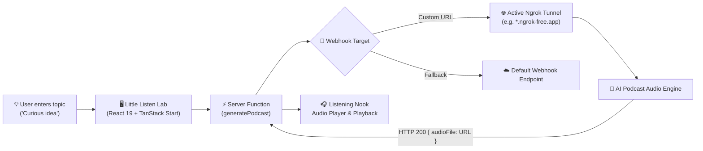

<div align="center">

# 🎙️ Little Listen Lab

**Make a little listening magic — turn curious ideas into bespoke podcast episodes.**

[](https://react.dev)
[](https://tanstack.com/start)
[](https://tailwindcss.com)
[](https://www.typescriptlang.org)
[](https://vitejs.dev)
[](https://vitest.dev)

<br />

<p align="center">
  <a href="#-features">Features</a> •
  <a href="#-how-it-works">How It Works</a> •
  <a href="#-webhook-integration">Webhook Setup</a> •
  <a href="#-getting-started">Quickstart</a> •
  <a href="#-project-structure">Architecture</a>
</p>

---

</div>

## ✨ What is Little Listen Lab?

**Little Listen Lab** (Podcaster) is a warm, minimal web application that transforms user-requested topics into custom audio podcast episodes on demand.

Whether you're pondering _"The secret social lives of octopuses"_ or _"Why sourdough bubbles form tiny universes"_, Little Listen Lab dispatches your topic to your active AI podcast generation pipeline and renders the finished audio right inside your browser.

---

## ⚡ Key Highlights

- 🔗 **Hot-Swappable Webhook Switcher:** Using a free **ngrok** tunnel whose URL changes every time you restart it? Just click the **chain link icon in the top right corner**, paste your active endpoint, and it immediately persists in browser `localStorage`. No rebuilds, no environment reboots.
- 🎙️ **Topic-to-Podcast Engine:** Simply type any question or prompt (up to 500 characters). Full schema validation with Zod guarantees clean, sanitized payloads.
- 📻 **Cozy Listening Nook:** Built-in audio player with custom loading states, pulsing waveforms, and friendly status feedback.
- 🎨 **Artisan Pastel Aesthetic:** Styled using modern **Tailwind CSS v4** with a custom **OKLCH** color system (warm coral, sunny butter, soft mint, and lilac accents) and DM Sans typography.
- 🛡️ **Edge-Ready & Type-Safe:** Built on **TanStack Start**, **TanStack Router**, and **Nitro** server functions with end-to-end TypeScript safety and CSRF protection.

---

## 🛠️ How It Works



---

## 🔌 Webhook Integration & Ngrok Tunneling

Little Listen Lab connects to any podcast-generating webhook service with a simple contract:

### 1. Request Payload (`POST`)

When you submit a topic, the server function sends:

```json
{
  "text": "The hidden mathematics of honeycombs"
}
```

### 2. Expected Response (`JSON`)

Your webhook should return a JSON object with a URL pointing to the generated audio file:

```json
{
  "audioFile": "https://your-audio-host.com/episodes/honeycomb-math.mp3"
}
```

### 3. Using Free Ngrok Tunnels

Free ngrok tunnels assign a dynamic subdomain on every launch:

1. Start your local podcast generator service:
   ```sh
   # e.g., your local API on port 5678
   ngrok http 5678
   ```
2. Copy your forwarding URL (e.g. `https://a1b2-34-56-78-90.ngrok-free.app/webhook-test/endpoint`).
3. Click the **Link Icon (🔗)** in the top right corner of Little Listen Lab.
4. Paste the URL and click **Save Webhook**. You're ready to generate!

---

## 🚀 Getting Started

### Prerequisites

- **Node.js** (v20+ recommended)
- **npm**

### 1. Clone the repository

```sh
git clone https://github.com/sgnancharan/little-listen-lab.git
cd little-listen-lab
```

### 2. Install dependencies

```sh
npm install
```

### 3. Run the development server

```sh
npm run dev
```

Visit [http://localhost:3000](http://localhost:3000) in your browser.

### 4. Run tests

```sh
npm test
```

### 5. Build for production

```sh
npm run build
npm run preview
```

---

## 📂 Project Architecture

```
little-listen-lab/
├── src/
│   ├── assets/                 # Brand illustrations & imagery
│   ├── components/ui/          # Radix UI + Tailwind primitives (Dialog, Button, Input, etc.)
│   ├── lib/
│   │   ├── podcast.ts          # Zod schemas & URL validation
│   │   ├── podcast.functions.ts# TanStack Start server function for webhook calls
│   │   └── utils.ts            # Class merging & utility helpers
│   ├── routes/
│   │   ├── __root.tsx          # HTML shell, fonts, & global providers
│   │   └── index.tsx           # Main Podcaster studio & Webhook Configuration dialog
│   ├── test/                   # Vitest unit & routing tests
│   ├── styles.css              # Tailwind v4 entry & OKLCH color token system
│   ├── start.ts                # TanStack Start instance & CSRF middleware
│   └── server.ts               # SSR entry handler
├── package.json
├── vite.config.ts              # Vite & TanStack Start build configuration
└── vitest.config.ts            # Vitest environment setup
```

---

## 🧪 Quality & Standards

- **Strict Validation:** Input limits (1–500 chars) and audio URL security checks.
- **Accessible UI:** WCAG compliant dialog traps, keyboard navigation, and screen reader announcements.
- **Zero Platform Lock-in:** Clean standard React 19 and TanStack Start stack.

---

<div align="center">

Made with curious minds in mind • A new perspective, one play at a time ✿

</div>
